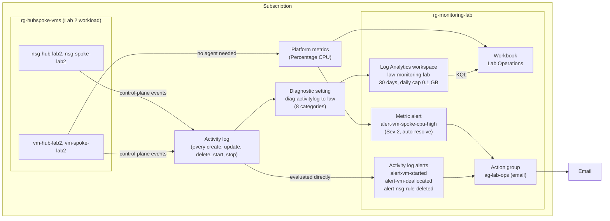
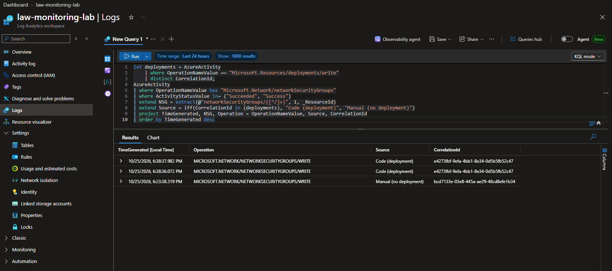
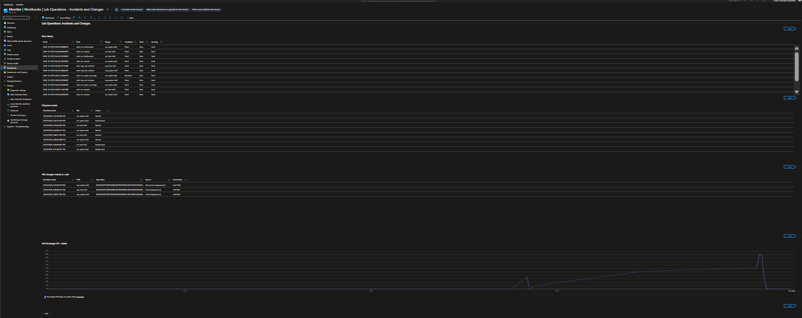

# Azure Monitoring and Incident Response

Azure Monitor lab: Log Analytics, KQL, Activity log and metric alerts, action groups, and a workbook. Each resource is built in the portal first, then codified in Bicep and verified with what-if. Controlled failures are documented with root-cause analysis and evidence. Built as a hands-on project while studying for **AZ-104: Microsoft Azure Administrator**. This is lab work in a personal subscription, not a production environment.

> **Status:** M1–M6 complete. Every result below comes from a live deployment, with sanitized evidence in [`docs/evidence/`](docs/evidence/). Root-cause reports: [RCA-001](docs/rca/rca-001-nsg-rule-deleted-ssh-outage.md) (NSG incident), [RCA-002](docs/rca/rca-002-cpu-metric-alert.md) (metric alert test). Interview notes: [`docs/interview-guide.md`](docs/interview-guide.md).

## Problem It Solves

Operations teams need to **detect** changes and failures automatically, **investigate** them with logs, and **prove** what happened. In this portfolio's [hub-and-spoke Lab 2](https://github.com/ChefBoyRJeff/azure-hub-spoke-network#lab-2-portal-built-connectivity-validation), an interrupted test script left a VM running, and nobody knew until someone checked by hand. This project builds the monitoring that would have caught it, then breaks the lab on purpose to test it.

**Most important result:** the alert built to catch a deleted NSG rule **didn't fire** when the rule was deleted in the portal. The investigation found why, fixed the rule in code, and proved the fix with a live event ([RCA-001](docs/rca/rca-001-nsg-rule-deleted-ssh-outage.md)).

## Milestones

| # | Milestone | Status | Result |
|---|---|---|---|
| M1 | Log Analytics workspace, action group, Activity log → workspace | ✅ | Activity log queryable with KQL at $0 (`_IsBillable = false`) |
| M2 | Activity log alerts: VM started / deallocated | ✅ | Both fired; detection 7–8 min |
| M3 | Incident: "SSH to the spoke stopped working" (NSG rule deleted in the portal) | ✅ | **Alert missed it.** Root cause found, condition fixed, fix proven; restored through Bicep; Lab 2 test matrix passed |
| M4 | Metric alert: high CPU, fired and resolved | ✅ | Fired 7.3 min after load started; resolved about 8 min after it ended; one instance stranded |
| M5 | Workbook: alert history, VM power, NSG changes (manual vs. code), CPU | ✅ | Portal-built, then codified with a tokenized template |
| M6 | RCAs, README, interview guide, teardown | ✅ | This document |

## Architecture



- **Activity log alerts** evaluate the Activity log **directly**. They don't depend on the workspace, so they kept working while workspace delivery was delayed (troubleshooting case 2). They're **stateless**: one alert per event, never "resolved".
- **The metric alert** evaluates platform metrics. It's **stateful**: it fires, then resolves on its own (`autoMitigate`).
- **The workspace** is for investigation (KQL), not detection. Only the free `AzureActivity` table is ingested.

## What's Deployed

| Resource | Name | Key settings |
|---|---|---|
| Resource group | `rg-monitoring-lab` | eastus; standard tags |
| Log Analytics workspace | `law-monitoring-lab` | Pay-as-you-go (PerGB2018); 30-day retention; **daily cap 0.1 GB**; resource-context access mode |
| Action group | `ag-lab-ops` | Short name `lab-ops`; one email receiver; region Global |
| Subscription diagnostic setting | `diag-activitylog-to-law` | All 8 Activity log categories → `law-monitoring-lab` |
| Activity log alert | `alert-vm-started` | Scope `rg-hubspoke-vms`; `Microsoft.Compute/virtualMachines/start/action`; Succeeded |
| Activity log alert | `alert-vm-deallocated` | Scope `rg-hubspoke-vms`; `.../virtualMachines/deallocate/action`; Succeeded |
| Activity log alert | `alert-nsg-rule-deleted` | Scope `rg-hubspoke-vms`; **any of** `.../securityRules/delete` or `.../networkSecurityGroups/write`; Succeeded. **Code-only** (the wizard can't build `anyOf`) |
| Metric alert | `alert-vm-spoke-cpu-high` | `vm-spoke-lab2`; Percentage CPU, Average > 80; window 5 min, frequency 1 min; Sev 2; auto-resolve. **About USD 0.10/month** |
| Workbook | Lab Operations - Incidents and Changes | Alert history (Resource Graph), VM power events (KQL), NSG changes manual vs. code (KQL), CPU (metrics) |

All of it is declared in [`infra/main.bicep`](infra/main.bicep) and [`infra/modules/monitoring.bicep`](infra/modules/monitoring.bicep).

## How It Was Built: Portal First, Then Code

The AZ-104 exam expects portal fluency as well as CLI and Bicep, so each resource type was built **in the portal first**, then codified:

1. Build it in the Azure portal and capture screenshots of the successful result.
2. Export what Azure actually stored (`az ... show -o json`, kept in the gitignored `infra/export/`). The portal adds defaults and renames things. For example, it stored the email receiver as `email-ops_-EmailAction-`.
3. Write Bicep that matches the stored state.
4. Run **what-if against the portal build**. The goal is **NoChange**, apart from known what-if blind spots.
5. From then on, change everything **through code**, and investigate in the portal.

| Milestone | What-if vs. portal build | Evidence |
|---|---|---|
| M1 | RG, workspace, diagnostic setting: **NoChange** (plus an intended removal of two test tags) | `m1-07` |
| M2 | Both VM alert rules: **NoChange** first time | `m2-04` |
| M3/M4 | NSG alert: **NoChange**. Metric alert: a false change from `reference()`, fixed in code, then **NoChange** | `m3m4-01`, `m3m4-02` |
| M5 | Workbook: only `serializedData` reported, a known blind spot (see case 12) | `m5-03` |

The action group always shows `emailAddress → [parameters('alertEmail')]`. That's expected, because what-if can't evaluate `@secure()` values (case 4).

## Results

### M1: Activity Log in Log Analytics

| Measure | Result |
|---|---|
| `_IsBillable` | **False** for every row (294 rows by end of M5, `m5-01`). `AzureActivity` ingestion is free |
| Latency once data was flowing | Average **4.6 min**, maximum **8 min** |


### M2: VM Power Alerts

Start `vm-spoke-lab2`, then deallocate it immediately (`m2-02`). Both alerts fired, and emails arrived at fire time. Both were then **closed** through the alert lifecycle with a comment.


### Activity Log Alert Detection Time (All Tests)

Event time from the Activity log vs. fire time from the Alerts Management API (`m2-03`, `m5-01`):

| Alert | Target | Event (UTC) | Fired (UTC) | Detection |
|---|---|---|---|---|
| `alert-vm-started` | vm-spoke-lab2 | 18:41:33 | 18:49:29 | 7.9 min |
| `alert-vm-deallocated` | vm-spoke-lab2 | 18:42:15 | 18:49:29 | 7.2 min |
| `alert-vm-started` | vm-hub-lab2 | 22:25:28 | 22:29:28 | 4.0 min |
| `alert-vm-started` | vm-spoke-lab2 | 22:26:38 | 22:29:28 | 2.8 min |
| `alert-nsg-rule-deleted` | nsg-spoke-lab2 | 22:38:37 | 22:39:28 | 0.8 min |
| `alert-nsg-rule-deleted` | nsg-hub-lab2 | 22:38:36 | 22:44:29 | 5.9 min |
| `alert-vm-started` | vm-hub-lab2 | 22:48:27 | 22:54:28 | 6.0 min |
| `alert-vm-started` | vm-spoke-lab2 | 22:48:40 | 22:54:28 | 5.8 min |
| `alert-vm-deallocated` | vm-hub-lab2 | 22:50:59 | 22:54:28 | 3.5 min |
| `alert-vm-deallocated` | vm-spoke-lab2 | 22:51:38 | 22:59:28 | 7.8 min |

**Range 0.8–7.9 minutes.** Every alert fired at **x4:28 or x9:28** past the hour, so they appear to be evaluated in 5-minute batches. Detection time depends mostly on where the event lands in that cycle. That's an observation from 10 data points, not documented behavior. Design implication: Activity log alerts answer "tell me this happened, within minutes". They aren't a near-real-time control.

### M3: Incident: SSH from Hub to Spoke Stopped Working

Full report: **[RCA-001](docs/rca/rca-001-nsg-rule-deleted-ssh-outage.md)**.

| Step | What happened | Evidence |
|---|---|---|
| Break | `Allow-SSH-From-Hub-Shared` (priority 100) deleted from `nsg-spoke-lab2` **in the portal** at 22:23:38 | `m3-02` |
| Symptom | Hub → spoke TCP 22 **timed out** (dropped, not refused) | `m3-03` |
| Detection | **`alert-nsg-rule-deleted` didn't fire** | `m3-04` |
| Root cause | The rule matched `securityRules/delete`. A portal deletion is logged as **`networkSecurityGroups/write`** | `m3-04` |
| Who / how | KQL `CorrelationId` join: the write had **no matching deployment**, so it was a manual change | `m5-01` query A |
| Remediation | Lab 2 Bicep redeployed (drift correction); alert changed to `anyOf` both operations | `m3-05`…`m3-08` |
| Verification | TCP 22 succeeded; **the corrected alert fired on the remediation write** (0.8 min); Lab 2 matrix passed with IP flow verify | `m3-06`, `m3-09`, `m5-01` |

Time from break to restore: **15.6 minutes.** Nothing would have alerted without the fix.



### M4: Metric Alert: High CPU

Full report: **[RCA-002](docs/rca/rca-002-cpu-metric-alert.md)**.

| Measure | Result |
|---|---|
| Load | `scripts/cpu-load.sh` through Run Command: busy loop, self-limited to 720 s |
| Load start → **Fired** | 22:27:03 → 22:34:20 = **7.3 min** |
| Load end → **Resolved** | about 22:39 → 22:47 = **about 8 min** (email received) |
| Unexpected | The **first instance was never resolved**. A second instance opened at 22:40:22 and resolved. Hypothesis: redeploying the unchanged rule at 22:38 (for the M3 fix) reset its state. Not confirmed |

### M5: Workbook

One page for the incidents above:

| Section | Data source | Shows |
|---|---|---|
| Alert history | Azure Resource Graph (`alertsmanagementresources`) | Every fired alert: rule, target, Fired/Resolved, lifecycle state |
| VM power events | KQL on `AzureActivity` | When each VM started or was deallocated (compute billing on/off) |
| NSG changes: manual vs. code | KQL on `AzureActivity`, `CorrelationId` join | The M3 incident (manual) and its remediation (code) |
| VM Percentage CPU | Platform metrics | The M4 load |



**Codifying it:** a workbook's content is a JSON string (`serializedData`) that contains the subscription ID. It's stored in [`infra/workbooks/lab-operations.workbook`](infra/workbooks/lab-operations.workbook) with a `{subscriptionId}` token, and the template fills it in at deploy time:

```bicep
serializedData: replace(loadTextContent('../workbooks/lab-operations.workbook'), '{subscriptionId}', subscription().subscriptionId)
```

## Troubleshooting Cases

| # | Symptom | Root cause | Resolution | Evidence |
|---|---|---|---|---|
| 1 | Creating the action group failed: *"The subscription is not registered to use namespace 'microsoft.insights'"* | The `Microsoft.Insights` resource provider wasn't **registered**. `Microsoft.AlertsManagement` was also missing | Registered both (approved, subscription-wide, no cost) | `m1-02a`, `m1-02b` |
| 2 | `AzureActivity` stayed empty after the diagnostic setting was created | Configuration was correct at every step. The new setting took **about 45 minutes to start exporting**, and events in that window were never delivered. No documented cause | Waited rather than recreating it; verified source vs. destination | `m1-05` |
| 3 | The portal showed *"You don't have access"* on the action group | Error **401**: an **expired token** (authentication), not a missing role (403) | Signed in again. No role change | Session notes |
| 4 | What-if showed the action group email changing to `[parameters('alertEmail')]` | What-if **doesn't evaluate `@secure()` parameters**. The local parameter file still held the placeholder; deploying would have **silently redirected alerts** | Fixed the file; action group test after every deploy | `m1-07`, `m1-09` |
| 5 | The alert wizard listed two "Start virtual machine" signals | One maps to **`Microsoft.DevTestLab`** and would never fire for these VMs | Chose the `Microsoft.Compute` signal; verified the operation name | `m2-01` |
| 6 | The NSG alert rule appeared in `rg-hubspoke-vms` | The wizard's resource group field **pre-fills from the selected scope** | Recreated in `rg-monitoring-lab`; removed the copy | `m3-01` |
| 7 | **NSG rule deleted in the portal; no alert** | Portal deletion = `networkSecurityGroups/write`, not `securityRules/delete` | `anyOf` both operations; proven live | [RCA-001](docs/rca/rca-001-nsg-rule-deleted-ssh-outage.md) |
| 8 | What-if reported a change to the metric alert's `targetResourceRegion` on every run | What-if **can't evaluate `reference()`** (used through `monitoredVm.location`) | Used the `location` parameter instead; what-if → NoChange | `m3m4-01`, `m3m4-02` |
| 9 | `az rest` silently ignored query parameters (`canFetchContent`, `timeRange`) | On Windows, `az` is a batch file (`az.cmd`), and **cmd.exe cuts the URL at `&`** | Pass them with `--url-parameters` | `scripts/Test-LabStatus.ps1` |
| 10 | KQL `VM` and `NSG` columns came back empty | `extract()` is **case-sensitive**, and `_ResourceId` is lowercase | Added `(?i)` to the regex | Workbook queries |
| 11 | A PowerShell report printed `status=bool Equals(...)` | `$_.equals` resolved to the .NET **`Equals()` method**, not the JSON property | `PSObject.Properties['equals'].Value` | Session notes |
| 12 | What-if always showed the workbook's `serializedData` as added | A GET of a workbook **omits its content** unless `canFetchContent=true`, so what-if has nothing to compare | Verified by fetching the content with `--url-parameters canFetchContent=true` | `m5-03` |
| 13 | **The subscription ID was found in four committed evidence files** (and one in Project 4) | The pre-commit redaction **only matched emails**, and pushed files weren't re-checked | Sanitized; **rewrote history** (`git filter-branch`), force-pushed with lease, verified with `git log -S`. Leak check now scans **GUIDs** too | Commit history |

## Deploy It Yourself

**Prerequisites:** an Azure subscription, the Azure CLI, Bicep, and Owner or Contributor rights. Register the providers first:

```powershell
az provider register -n Microsoft.Insights --wait
az provider register -n Microsoft.AlertsManagement --wait
```

**Parameters:** the alert email is private, so it lives in a gitignored file.

```powershell
Copy-Item infra\main.example.bicepparam infra\main.local.bicepparam
# edit infra\main.local.bicepparam and set alertEmail, then save
```

| File | Committed? | Purpose |
|---|---|---|
| `infra/main.example.bicepparam` | Yes | Template with a placeholder email |
| `infra/main.local.bicepparam` | **No** (`*.local.bicepparam` is gitignored) | Your real values |

**Preview and deploy** (subscription scope):

```powershell
az deployment sub what-if -l eastus -f infra\main.bicep -p infra\main.local.bicepparam
az deployment sub create  -l eastus -n monitoring-foundation -f infra\main.bicep -p infra\main.local.bicepparam
```

**After every deployment:**
1. Test the action group (Monitor → Alerts → Action groups → `ag-lab-ops` → Test). What-if can't verify the secure email value.
2. Check for alerts still in the *Fired* condition (RCA-002).

The alerts monitor `rg-hubspoke-vms` (`monitoredResourceGroupName`), and the CPU alert watches `vm-spoke-lab2` (`cpuAlertVmName`), which must exist first. A new diagnostic setting can take a while before data appears; confirm `AzureActivity` has rows before relying on it.

**Status check** (read-only, $0):

```powershell
.\scripts\Test-LabStatus.ps1 -OutFile status.txt
```

It reports VM power state, NSG rules, alert rules, fired alerts, and runs the workbook's KQL queries.

## Repository Structure

```
├── infra/
│   ├── main.bicep                     # Subscription scope: RG, monitoring module, Activity log diagnostic setting
│   ├── main.example.bicepparam        # Parameter template (placeholder email)
│   ├── modules/
│   │   └── monitoring.bicep           # Workspace, action group, Activity log alerts (loop), metric alert, workbook
│   └── workbooks/
│       └── lab-operations.workbook    # Workbook content with a {subscriptionId} token
├── scripts/
│   ├── Test-LabStatus.ps1             # Read-only status check and KQL queries
│   ├── cpu-load.sh                    # M4: self-limiting CPU load (Run Command)
│   └── ssh-check-from-hub.sh          # M3: TCP 22 check from the hub VM (Run Command)
└── docs/
    ├── plan.md                        # Approved project plan
    ├── interview-guide.md             # Walkthrough, deep dive, likely questions
    ├── rca/                           # Root-cause reports (RCA-001, RCA-002)
    ├── evidence/                      # Sanitized command output per milestone
    └── screenshots/                   # Sanitized portal screenshots of successful results
```

Gitignored: `infra/*.local.bicepparam`, `infra/export/`, `docs/screenshots/raw/`, compiled `*.json`, `.vscode/`.

## Cost

| Item | Cost |
|---|---|
| Activity log collection and `AzureActivity` ingestion | $0 (free table, `_IsBillable = false`) |
| Activity log alert rules (3) | $0 |
| Platform metrics | $0 (no agent) |
| **Metric alert rule** | **About USD 0.10/month** (portal estimate, one time series). **The only ongoing charge** |
| Action group email | $0 (up to 1,000 per month) |
| Workspace | $0 (no billable data; daily cap 0.1 GB as a guardrail) |
| Workbook | $0 |
| Test VM runtime | M2: about 1.5 min. M3+M4: about 27 min of two B1s VMs (about $0.01). VMs deallocated after every test |

## Security and Privacy

- The alert email comes from a gitignored `*.local.bicepparam` file and is marked `@secure()`, so it stays out of deployment history.
- No subscription or tenant IDs in code. Scopes use `subscription().id`; the workbook uses a token.
- Evidence files query **names only**. Before every commit, staged files are scanned for **email addresses and GUIDs** (case 13), and correlation IDs are shortened to 8 characters.
- The `Caller` field (who made a change) was reviewed in the portal but not committed, because it's an email address.
- Screenshots are saved to a gitignored `raw/` folder first and checked or redacted before being committed.

## Teardown

**To stop the only ongoing charge but keep the lab:** delete the metric alert.

```powershell
az monitor metrics alert delete -g rg-monitoring-lab -n alert-vm-spoke-cpu-high
```

It's in the Bicep, so the next deployment recreates it.

**Full teardown:**
1. Close any open alerts (Monitor → Alerts → select → Change state → Closed).
2. Delete `rg-monitoring-lab` (workspace, action group, alert rules, workbook).
3. Delete the **subscription** diagnostic setting `diag-activitylog-to-law`. It lives outside the resource group, so deleting the RG doesn't remove it:

   ```powershell
   az monitor diagnostic-settings subscription delete -n diag-activitylog-to-law --yes
   ```
4. Optionally unregister `Microsoft.Insights` and `Microsoft.AlertsManagement` (only possible if no resources of those types remain).

The monitored Lab 2 environment isn't affected; see its own cost and preservation policy.

## Known Limitations

- **Activity log alerts take minutes** (0.8–7.9 min measured). They aren't a real-time control.
- **The NSG alert is noisy.** Matching `networkSecurityGroups/write` catches portal deletions, but also every NSG redeploy, including unchanged ones. One remediation produced three alerts, one of them unexplained. An alert processing rule during planned deployments would reduce this; not added.
- **The NSG alert detects; it doesn't prevent.** RBAC or a resource lock would prevent the change (Project 4 topics).
- **Redeploying an alert rule during an active alert may strand it** (RCA-002, hypothesis).
- **What-if blind spots:** `@secure()` values, `reference()`, and workbook content. Each has a workaround above.
- **Activity log alerts have no severity setting** (always Sev 4).
- **No alert for the daily cap.** If the cap is reached, billable data stops silently. Not added, because it would be a billable log alert.
- **The diagnostic setting's activation gap** (about 45 minutes, events lost) has no confirmed cause.
- **A VM shut down from inside the OS** (stopped, still billing) isn't alerted on. The alerts cover start and deallocate only.
- **Old commits are reachable by direct URL.** After the history rewrite (case 13), GitHub still serves pre-rewrite commits to anyone with the exact hash. They contain the subscription ID, an identifier that isn't a credential.

## AZ-104 Skills Demonstrated

| Objective (Monitor and maintain Azure resources) | Where |
|---|---|
| Interpret metrics in Azure Monitor | M4: Percentage CPU, 5-minute average; workbook metrics chart |
| Configure log settings in Azure Monitor | M1: subscription diagnostic setting |
| Query and analyze logs in Azure Monitor | M1, M3, M5: KQL over `AzureActivity` (`let`, `in`, `iff`, `extract`, `ingestion_time()`) |
| Set up alert rules, action groups, and alert processing rules | M1–M4: action group, Activity log alerts, metric alert, alert lifecycle |
| Use Azure Network Watcher | M3: IP flow verify in the Lab 2 test matrix |
| Manage subscriptions (resource providers) | Case 1 |
| Interpret and deploy Bicep files; export resources | All milestones: portal → export → Bicep → what-if |
| Configure network security groups | M3: diagnosing and restoring an NSG rule |
