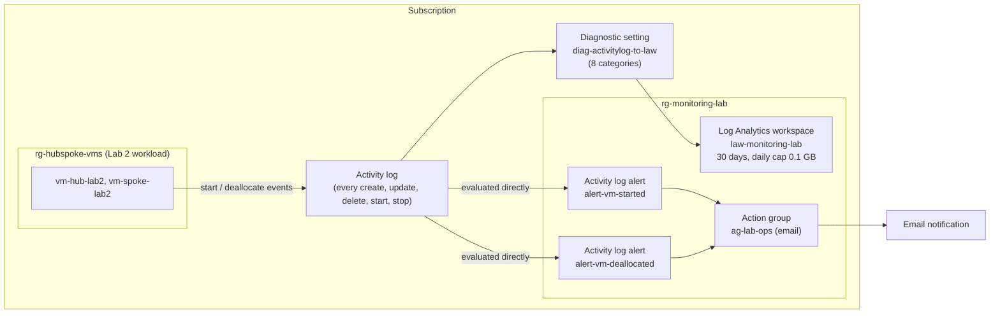
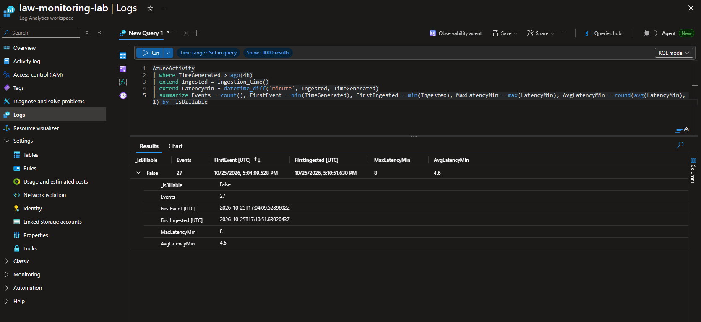
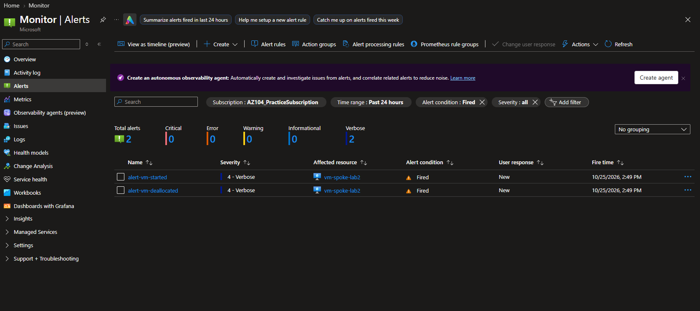

# Azure Monitoring and Incident Response

Azure Monitor lab: Log Analytics, KQL, Activity log and metric alerts, action groups, and workbooks. Each resource is built in the portal first, then codified in Bicep and verified with what-if. Controlled failures are documented with root-cause analysis and evidence. Built as a hands-on project while studying for **AZ-104: Microsoft Azure Administrator**. This is lab work in a personal subscription, not a production environment.

> **Status:** M1 and M2 are complete and verified. M3–M6 are planned. See [`docs/plan.md`](docs/plan.md) for the full plan.

## Problem It Solves

Operations teams need to **detect** changes and failures automatically, **investigate** them with logs, and **prove** what happened. In this portfolio's [hub-and-spoke Lab 2](https://github.com/ChefBoyRJeff/azure-hub-spoke-network#lab-2-portal-built-connectivity-validation), an interrupted test script left a VM running, and nobody knew until someone checked by hand. This project builds the monitoring that would have caught it. A VM in that lab now can't start without an email going out.

## Milestones

| # | Milestone | Status | Result |
|---|---|---|---|
| M1 | Log Analytics workspace, action group, Activity log → workspace | ✅ Done | Activity log queryable with KQL at $0 (`_IsBillable = false`) |
| M2 | Activity log alerts: VM started / deallocated | ✅ Done | Both fired in a live test; detection measured at 7–8 minutes |
| M3 | Incident: "SSH to the spoke stopped working" (NSG rule deleted) | Planned | |
| M4 | Metric alert: high CPU, fired and resolved | Planned | |
| M5 | Workbook | Planned | |
| M6 | Final documentation, interview guide, teardown | Planned | |

## Architecture



Activity log alerts evaluate the Activity log **directly**. They don't depend on the workspace, so they kept working even while workspace delivery was delayed (see the troubleshooting cases).

## What's Deployed

| Resource | Name | Key settings |
|---|---|---|
| Resource group | `rg-monitoring-lab` | eastus; standard tags |
| Log Analytics workspace | `law-monitoring-lab` | Pay-as-you-go (PerGB2018); 30-day retention; **daily cap 0.1 GB**; resource-context access mode |
| Action group | `ag-lab-ops` | Short name `lab-ops`; one email receiver; region Global |
| Subscription diagnostic setting | `diag-activitylog-to-law` | All 8 Activity log categories → `law-monitoring-lab` |
| Activity log alert | `alert-vm-started` | Scope `rg-hubspoke-vms`; `Microsoft.Compute/virtualMachines/start/action`; status Succeeded |
| Activity log alert | `alert-vm-deallocated` | Scope `rg-hubspoke-vms`; `Microsoft.Compute/virtualMachines/deallocate/action`; status Succeeded |

## How It Was Built: Portal First, Then Code

The AZ-104 exam expects portal fluency as well as CLI and Bicep, so every resource type was built **in the portal first**, then codified:

1. Build it in the Azure portal and capture screenshots of the successful result.
2. Export what Azure actually stored (`az ... show -o json`, kept in the gitignored `infra/export/`). The portal adds defaults and renames things. For example, it stored the email receiver as `email-ops_-EmailAction-`, not `email-ops`.
3. Write Bicep that matches the stored state.
4. Run **what-if against the portal build**. The goal is **NoChange**.
5. From then on, change everything **through code**, and investigate in the portal.

| Milestone | What-if vs. portal build | Evidence |
|---|---|---|
| M1 | RG, workspace, diagnostic setting: **NoChange**. The RG showed only the removal of two temporary test tags (an intended cleanup) | `m1-07` |
| M2 | Both alert rules: **NoChange** on the first attempt | `m2-04` |

The M1 code was then **deployed** (Succeeded in 26 s) and drift-checked (`m1-08`, `m1-09`). M2 needed no deployment, because the code already described what was running.

## Results

### M1: Activity Log in Log Analytics

```kusto
AzureActivity
| where TimeGenerated > ago(4h)
| extend Ingested = ingestion_time()
| extend LatencyMin = datetime_diff('minute', Ingested, TimeGenerated)
| summarize Events = count(), FirstEvent = min(TimeGenerated), FirstIngested = min(Ingested),
            MaxLatencyMin = max(LatencyMin), AvgLatencyMin = round(avg(LatencyMin), 1) by _IsBillable
```

| Measure | Result |
|---|---|
| `_IsBillable` | **False** for every row. `AzureActivity` ingestion is free, as Microsoft documents |
| Latency once data was flowing | Average **4.6 min**, maximum **8 min** |



### M2: VM Power Alerts

Test: start `vm-spoke-lab2`, then deallocate it immediately (about 1.5 minutes of runtime, deallocation in a `finally` block).

| Alert | VM action succeeded (UTC) | Alert fired (UTC) | Detection time | Email |
|---|---|---|---|---|
| `alert-vm-started` | 18:41:33 | 18:49:29 | **7.9 min** | Received at fire time |
| `alert-vm-deallocated` | 18:42:15 | 18:49:29 | **7.2 min** | Received at fire time |

**Observations:**
- Notification is effectively immediate. The delay is in **detection**.
- Both alerts fired at the **same second**, even though the events were 42 seconds apart. That suggests Activity log alerts are evaluated in batches (an observation, not confirmed).
- **Design implication:** Activity log alerts suit "tell me this happened" within minutes. They aren't a near-real-time control.
- Both fired alerts were then **closed** through the alert lifecycle (New → Closed) with a comment.



## Troubleshooting Cases

| # | Symptom | Root cause | Resolution | Evidence |
|---|---|---|---|---|
| 1 | Creating the action group failed: *"The subscription is not registered to use namespace 'microsoft.insights'"* | The `Microsoft.Insights` resource provider was **not registered**. The workspace worked because it uses a different provider (`Microsoft.OperationalInsights`). `Microsoft.AlertsManagement` was also unregistered and would have failed later | Registered both providers (approved, subscription-wide, no cost): 12 s and 73 s | `m1-02a`, `m1-02b` |
| 2 | `AzureActivity` stayed empty after the diagnostic setting was created | Configuration was correct at every step: the setting pointed at the exact workspace, its creation Succeeded, the source events existed, and the daily cap wasn't involved. The new setting took **about 45 minutes to start exporting**, and events in that window (12:20, 12:45) **were never delivered**. No documented cause | Waited rather than recreating the setting (a subscription-wide change that could restart the delay). Verified with the `Operation` table, the Tables list, `search *`, and source-vs-destination comparison | `m1-05` |
| 3 | The portal showed *"You don't have access"* on the action group | Error **401**: the portal's **access token had expired**. That's an authentication failure, not a missing permission (a 403). The CLI deployment had succeeded with the same account 2 minutes earlier | Refreshed and signed in again. No role change needed | Session notes |
| 4 | What-if showed the action group email changing to `[parameters('alertEmail')]` | **What-if doesn't evaluate `@secure()` parameters**, so it can't show the real value. The local parameter file still held the placeholder email; deploying would have **silently redirected alerts** | Fixed the parameter file before deploying; verified with an action group test after deploying | `m1-07`, `m1-09` |
| 5 | The alert wizard listed two "Start virtual machine" signals | The lowercase one maps to **`Microsoft.DevTestLab/labs/virtualMachines/Start/action`**, which would never fire for these VMs | Chose the `Microsoft.Compute` signal and verified the operation name from the Activity log link, then with the CLI | `m2-01` |

## Deploy It Yourself

**Prerequisites:** an Azure subscription, the Azure CLI, Bicep, and Owner or Contributor rights (registering resource providers requires them). Register the providers first:

```powershell
az provider register -n Microsoft.Insights --wait
az provider register -n Microsoft.AlertsManagement --wait
```

**Parameters:** the alert email is private, so it lives in a gitignored file.

```powershell
Copy-Item infra\main.example.bicepparam infra\main.local.bicepparam
# edit infra\main.local.bicepparam and set alertEmail, then save
```

| File | Committed? | Purpose |
|---|---|---|
| `infra/main.example.bicepparam` | Yes | Template with a placeholder email |
| `infra/main.local.bicepparam` | **No** (`*.local.bicepparam` is gitignored) | Your real values |

**Preview and deploy** (subscription scope):

```powershell
az deployment sub what-if -l eastus -f infra\main.bicep -p infra\main.local.bicepparam
az deployment sub create  -l eastus -n monitoring-foundation -f infra\main.bicep -p infra\main.local.bicepparam
```

**After every deployment,** test the action group (Monitor → Alerts → Action groups → `ag-lab-ops` → Test). What-if can't verify the secure email value.

The alerts monitor `rg-hubspoke-vms` (parameter `monitoredResourceGroupName`). A new subscription diagnostic setting can take a while before data appears; confirm `AzureActivity` has rows before relying on it.

## Repository Structure

```
├── infra/
│   ├── main.bicep                  # Subscription scope: RG, monitoring module, Activity log diagnostic setting
│   ├── main.example.bicepparam     # Parameter template (placeholder email)
│   └── modules/
│       └── monitoring.bicep        # Workspace, action group, VM power alerts
└── docs/
    ├── plan.md                     # Approved project plan
    ├── evidence/                   # Sanitized command output per milestone (m1-*, m2-*)
    └── screenshots/                # Sanitized portal screenshots of successful results
```

Gitignored: `infra/*.local.bicepparam`, `infra/export/`, `docs/screenshots/raw/`, and compiled `*.json`.

## Cost

| Item | Cost |
|---|---|
| Activity log collection and `AzureActivity` ingestion | $0 (free table, confirmed by `_IsBillable = false`) |
| Activity log alert rules | $0 |
| Action group email | $0 (up to 1,000 per month) |
| Workspace | $0 so far (no billable data; daily cap 0.1 GB as a guardrail) |
| M2 test VM runtime | About 1.5 minutes of one B1s VM (well under $0.01) |

## Security and Privacy

- The alert email is supplied from a gitignored `*.local.bicepparam` file. It's marked `@secure()`, so it stays out of deployment history.
- No subscription or tenant IDs are hard-coded. Scopes are built from `subscription().id`.
- Evidence files query **names only**. Remaining emails are redacted with a regex before committing, and a leak check runs before every commit.
- Screenshots are saved to a gitignored `raw/` folder first and checked or redacted before being committed.

## Teardown

1. Delete `rg-monitoring-lab` (the workspace, action group, and alert rules).
2. Delete the **subscription** diagnostic setting `diag-activitylog-to-law`. It lives outside the resource group, so deleting the RG doesn't remove it.
3. Optionally unregister `Microsoft.Insights` and `Microsoft.AlertsManagement`. Only possible if no resources of those types remain anywhere in the subscription.

The monitored Lab 2 environment is unaffected; see its own cost and preservation policy.

## Known Limitations

- **Activity log alerts take minutes**, not seconds (7–8 minutes measured). They aren't a real-time control.
- **Activity log alerts have no severity setting.** They always show as Sev 4 (Verbose).
- **What-if can't verify `@secure()` values.** An action group test after each deployment covers the gap.
- **No alert for the daily cap.** If the cap is reached, billable data stops silently until the next day. The portal recommends an alert for this; it's not added yet, because it would be a billable log alert.
- **The diagnostic setting's activation gap** (about 45 minutes, with events lost) has no confirmed cause.
- The alerts cover start and deallocate only. A VM **stopped from inside the OS** (still billing) isn't alerted on yet.

## AZ-104 Skills Demonstrated

| Objective (Monitor and maintain Azure resources) | Where |
|---|---|
| Configure log settings in Azure Monitor | M1: subscription diagnostic setting |
| Query and analyze logs in Azure Monitor | M1: KQL over `AzureActivity`, `Operation`, `search *`; ingestion latency |
| Set up alert rules, action groups, and alert processing rules | M1: action group; M2: Activity log alert rules; alert lifecycle |
| Manage subscriptions (resource providers) | Case 1: provider registration |
| Interpret and deploy Bicep files; export resources | M1/M2: portal → export → Bicep → what-if |
